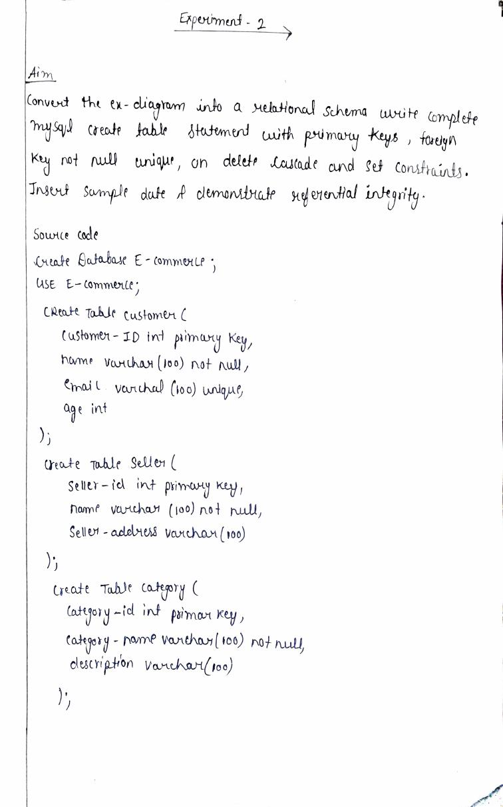
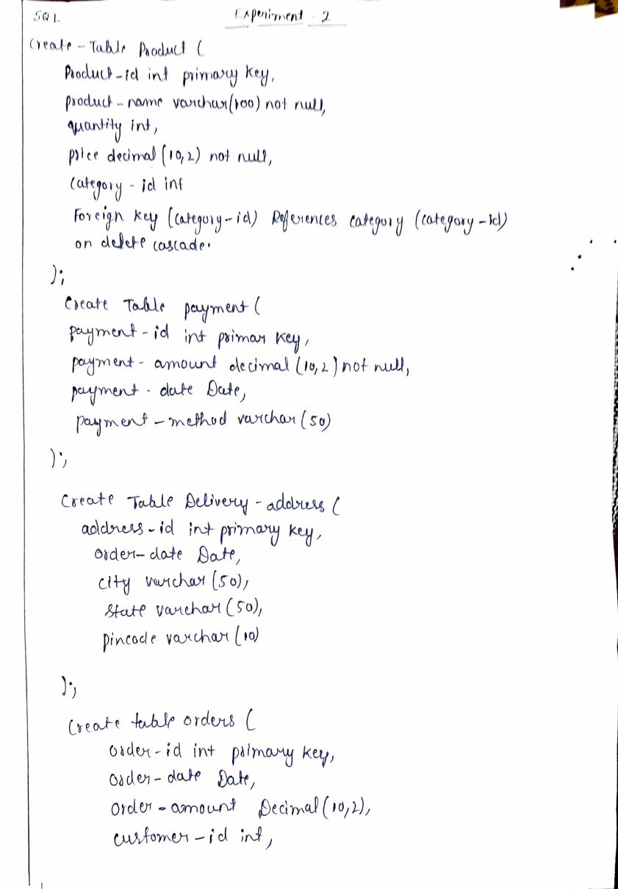
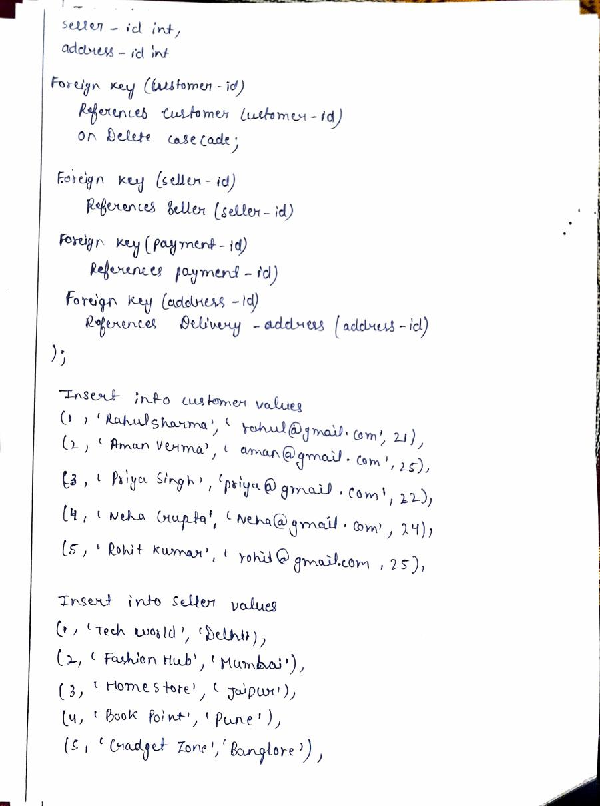
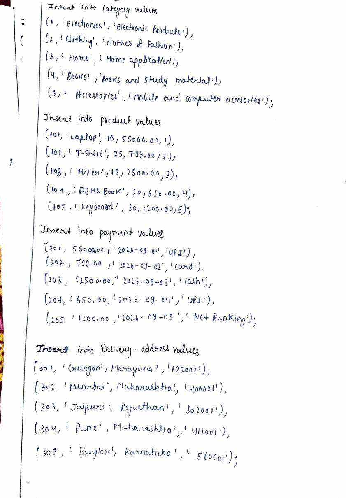
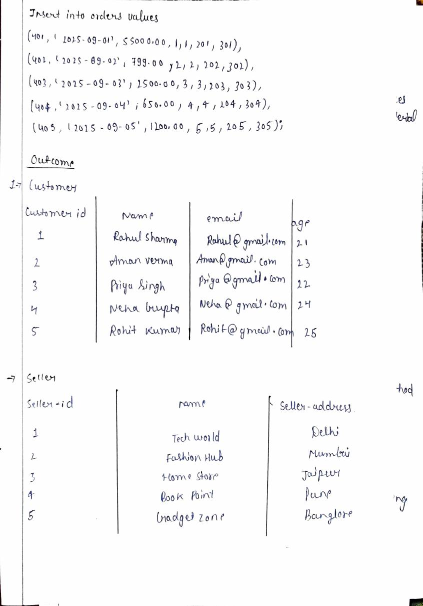
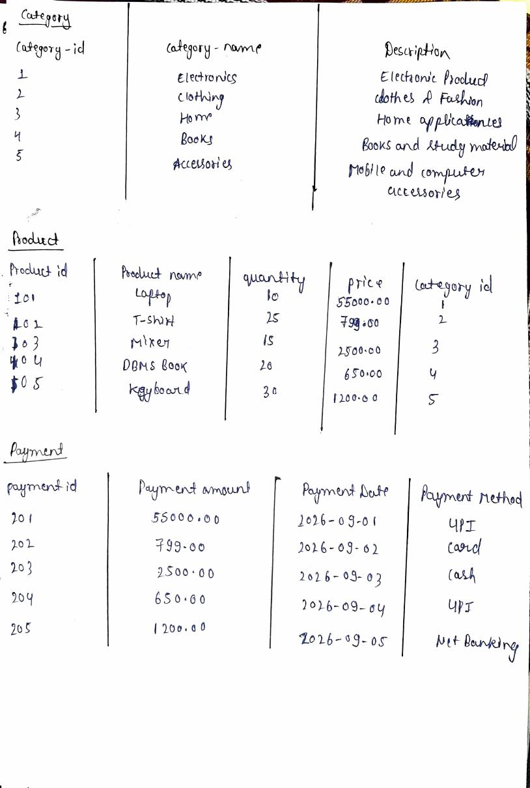
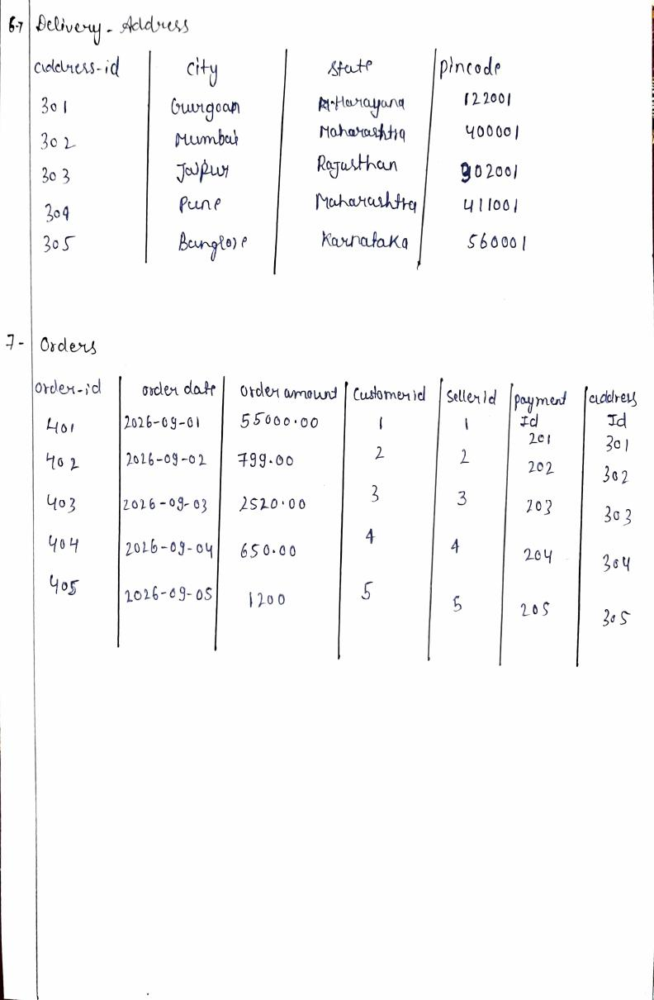

# EXPERIMENT - 2

## Aim

Convert the ER diagram into a relational schema. Write complete MySQL CREATE TABLE statements with primary keys, foreign keys, NOT NULL, UNIQUE, ON DELETE CASCADE and SET constraints. Insert sample data and demonstrate referential integrity.

## Relational Schema

| Table | Columns |
|---|---|
| Customer | customer_id (PK), name (NOT NULL), email (UNIQUE), age |
| Seller | seller_id (PK), name (NOT NULL), seller_address |
| Category | category_id (PK), category_name (NOT NULL), description |
| Product | product_id (PK), product_name (NOT NULL), quantity, price (NOT NULL), category_id (FK → Category) |
| Payment | payment_id (PK), payment_amount (NOT NULL), payment_date, payment_method |
| Delivery_Address | address_id (PK), city, state, pincode |
| Orders | order_id (PK), order_date, order_amount, customer_id (FK → Customer), seller_id (FK → Seller), payment_id (FK → Payment), address_id (FK → Delivery_Address) |

## Source Code

```sql
CREATE DATABASE E_commerce;
USE E_commerce;

CREATE TABLE Customer (
    customer_id INT PRIMARY KEY,
    name VARCHAR(100) NOT NULL,
    email VARCHAR(100) UNIQUE,
    age INT
);

CREATE TABLE Seller (
    seller_id INT PRIMARY KEY,
    name VARCHAR(100) NOT NULL,
    seller_address VARCHAR(100)
);

CREATE TABLE Category (
    category_id INT PRIMARY KEY,
    category_name VARCHAR(100) NOT NULL,
    description VARCHAR(100)
);

CREATE TABLE Product (
    product_id INT PRIMARY KEY,
    product_name VARCHAR(100) NOT NULL,
    quantity INT,
    price DECIMAL(10,2) NOT NULL,
    category_id INT,
    FOREIGN KEY (category_id) REFERENCES Category(category_id)
        ON DELETE CASCADE
);

CREATE TABLE Payment (
    payment_id INT PRIMARY KEY,
    payment_amount DECIMAL(10,2) NOT NULL,
    payment_date DATE,
    payment_method VARCHAR(50)
);

CREATE TABLE Delivery_Address (
    address_id INT PRIMARY KEY,
    city VARCHAR(50),
    state VARCHAR(50),
    pincode VARCHAR(10)
);

CREATE TABLE Orders (
    order_id INT PRIMARY KEY,
    order_date DATE,
    order_amount DECIMAL(10,2),
    customer_id INT,
    seller_id INT,
    payment_id INT,
    address_id INT,
    FOREIGN KEY (customer_id) REFERENCES Customer(customer_id)
        ON DELETE CASCADE,
    FOREIGN KEY (seller_id) REFERENCES Seller(seller_id)
        ON DELETE SET NULL,
    FOREIGN KEY (payment_id) REFERENCES Payment(payment_id)
        ON DELETE SET NULL,
    FOREIGN KEY (address_id) REFERENCES Delivery_Address(address_id)
        ON DELETE SET NULL
);
```

**Insert Customer**

```sql
INSERT INTO Customer VALUES
(1, 'Rahul Sharma', 'rahul@gmail.com', 21),
(2, 'Aman Verma', 'aman@gmail.com', 25),
(3, 'Priya Singh', 'priya@gmail.com', 22),
(4, 'Neha Gupta', 'neha@gmail.com', 24),
(5, 'Rohit Kumar', 'rohit@gmail.com', 25);
```

**Insert Seller**

```sql
INSERT INTO Seller VALUES
(1, 'Tech World', 'Delhi'),
(2, 'Fashion Hub', 'Mumbai'),
(3, 'Home Store', 'Jaipur'),
(4, 'Book Point', 'Pune'),
(5, 'Gadget Zone', 'Banglore');
```

**Insert Category**

```sql
INSERT INTO Category VALUES
(1, 'Electronics', 'Electronic Products'),
(2, 'Clothing', 'Clothes & Fashion'),
(3, 'Home', 'Home Application'),
(4, 'Books', 'Books and study material'),
(5, 'Accessories', 'Mobile and computer accessories');
```

**Insert Product**

```sql
INSERT INTO Product VALUES
(101, 'Laptop', 10, 55000.00, 1),
(102, 'T-Shirt', 25, 799.00, 2),
(103, 'Mixer', 15, 2500.00, 3),
(104, 'DBMS Book', 20, 650.00, 4),
(105, 'Keyboard', 30, 1200.00, 5);
```

**Insert Payment**

```sql
INSERT INTO Payment VALUES
(201, 55000.00, '2026-09-01', 'UPI'),
(202, 799.00, '2026-09-02', 'Card'),
(203, 2500.00, '2026-09-03', 'Cash'),
(204, 650.00, '2026-09-04', 'UPI'),
(205, 1200.00, '2026-09-05', 'Net Banking');
```

**Insert Delivery_Address**

```sql
INSERT INTO Delivery_Address VALUES
(301, 'Gurgaon', 'Haryana', '122001'),
(302, 'Mumbai', 'Maharashtra', '400001'),
(303, 'Jaipur', 'Rajasthan', '302001'),
(304, 'Pune', 'Maharashtra', '411001'),
(305, 'Banglore', 'Karnataka', '560001');
```

**Insert Orders**

```sql
INSERT INTO Orders VALUES
(401, '2026-09-01', 55000.00, 1, 1, 201, 301),
(402, '2026-09-02', 799.00, 2, 2, 202, 302),
(403, '2026-09-03', 2500.00, 3, 3, 203, 303),
(404, '2026-09-04', 650.00, 4, 4, 204, 304),
(405, '2026-09-05', 1200.00, 5, 5, 205, 305);
```

## Referential Integrity Demonstration

**1. Inserting an order with a customer that does not exist is rejected**

```sql
INSERT INTO Orders VALUES (406, '2026-09-06', 999.00, 99, 1, 201, 301);
-- ERROR 1452: Cannot add or update a child row: a foreign key constraint fails
```

**2. ON DELETE CASCADE: deleting a customer deletes that customer's orders**

```sql
DELETE FROM Customer WHERE customer_id = 5;
SELECT * FROM Orders WHERE customer_id = 5;   -- empty, order 405 was removed
```

**3. ON DELETE SET NULL: deleting a seller keeps the order but clears seller_id**

```sql
DELETE FROM Seller WHERE seller_id = 4;
SELECT order_id, seller_id FROM Orders WHERE order_id = 404;   -- seller_id is NULL
```

**4. ON DELETE CASCADE: deleting a category deletes its products**

```sql
DELETE FROM Category WHERE category_id = 5;
SELECT * FROM Product WHERE category_id = 5;   -- empty, Keyboard was removed
```

## Outcome

### 1. Customer

| customer_id | name | email | age |
|---|---|---|---|
| 1 | Rahul Sharma | rahul@gmail.com | 21 |
| 2 | Aman Verma | aman@gmail.com | 25 |
| 3 | Priya Singh | priya@gmail.com | 22 |
| 4 | Neha Gupta | neha@gmail.com | 24 |
| 5 | Rohit Kumar | rohit@gmail.com | 25 |

### 2. Seller

| seller_id | name | seller_address |
|---|---|---|
| 1 | Tech World | Delhi |
| 2 | Fashion Hub | Mumbai |
| 3 | Home Store | Jaipur |
| 4 | Book Point | Pune |
| 5 | Gadget Zone | Banglore |

### 3. Category

| category_id | category_name | description |
|---|---|---|
| 1 | Electronics | Electronic Products |
| 2 | Clothing | Clothes & Fashion |
| 3 | Home | Home Application |
| 4 | Books | Books and study material |
| 5 | Accessories | Mobile and computer accessories |

### 4. Product

| product_id | product_name | quantity | price | category_id |
|---|---|---|---|---|
| 101 | Laptop | 10 | 55000.00 | 1 |
| 102 | T-Shirt | 25 | 799.00 | 2 |
| 103 | Mixer | 15 | 2500.00 | 3 |
| 104 | DBMS Book | 20 | 650.00 | 4 |
| 105 | Keyboard | 30 | 1200.00 | 5 |

### 5. Payment

| payment_id | payment_amount | payment_date | payment_method |
|---|---|---|---|
| 201 | 55000.00 | 2026-09-01 | UPI |
| 202 | 799.00 | 2026-09-02 | Card |
| 203 | 2500.00 | 2026-09-03 | Cash |
| 204 | 650.00 | 2026-09-04 | UPI |
| 205 | 1200.00 | 2026-09-05 | Net Banking |

### 6. Delivery_Address

| address_id | city | state | pincode |
|---|---|---|---|
| 301 | Gurgaon | Haryana | 122001 |
| 302 | Mumbai | Maharashtra | 400001 |
| 303 | Jaipur | Rajasthan | 302001 |
| 304 | Pune | Maharashtra | 411001 |
| 305 | Banglore | Karnataka | 560001 |

### 7. Orders

| order_id | order_date | order_amount | customer_id | seller_id | payment_id | address_id |
|---|---|---|---|---|---|---|
| 401 | 2026-09-01 | 55000.00 | 1 | 1 | 201 | 301 |
| 402 | 2026-09-02 | 799.00 | 2 | 2 | 202 | 302 |
| 403 | 2026-09-03 | 2500.00 | 3 | 3 | 203 | 303 |
| 404 | 2026-09-04 | 650.00 | 4 | 4 | 204 | 304 |
| 405 | 2026-09-05 | 1200.00 | 5 | 5 | 205 | 305 |

## Result

The ER diagram was converted into a relational schema in MySQL with primary keys, foreign keys, NOT NULL, UNIQUE, ON DELETE CASCADE and ON DELETE SET NULL constraints. Sample data was inserted and referential integrity was demonstrated.

---

Original handwritten notes:








